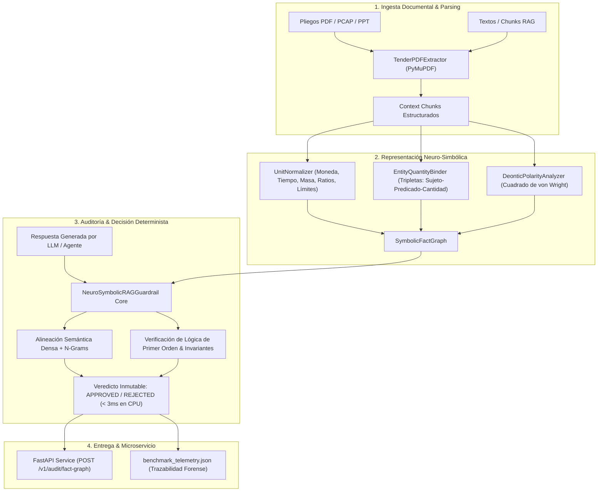

# `neurosymbolic-rag-guardrail`: Production Neuro-Symbolic RAG Guardrail & Public Procurement Fact-Graph Auditor

> **Librería / PoC Sectorial:** Verificación formal deóntica y factual para motores RAG y pipelines multiagente de baja latencia sin alucinaciones.
> **Autor:** Juan Diego Ussa Aponte (Valencia, España)
> **Aplicación Sectorial:** Auditoría de licitaciones públicas, cumplimiento normativo corporativo, acuerdos de nivel de servicio (SLAs) y agentes clínicos.
> **Enfoque Arquitectónico:** Lógica deóntica formal computable (Cuadrado de von Wright), grafos locales de hechos estructurados y microservicio FastAPI en tiempo real (< 3 ms en CPU).

---

## 1. El Problema Técnico Sectorial (Más Allá de un Guardrail Heurístico)

En entornos corporativos y regulados (licitaciones públicas, cumplimiento normativo, contratos y salud), emplear un segundo LLM como evaluador (*LLM-as-a-judge*) introduce **> 1.500 ms de latencia**, costes elevados de tokens y riesgo recurrente de alucinaciones recursivas. Por otro lado, los evaluadores puramente vectoriales o basados en similitud coseno sufren **4 modos de fallo críticos**:

1. **Inversión Relacional (*Relational Swap Hallucination*):**  
   Si el pliego dice *"En el Lote 1 el presupuesto máximo es de 50.000 € y en el Lote 2 es de 120.000 €"* y el modelo generativo responde *"En el Lote 1 el presupuesto es de 120.000 € y en el Lote 2 es de 50.000 €"*, una resta de conjuntos de números (`ans_nums - ctx_nums`) devuelve vacío y **aprueba erróneamente la alucinación**.
2. **Inversión de Polaridad Deóntica (*Deontic Negation Flip*):**  
   Si el documento fuente establece *"La directiva prohíbe almacenar credenciales en texto plano"* (o *"Es obligatorio acreditar certificado ENS"*) y el LLM genera *"La directiva permite almacenar credenciales en texto plano"* (o *"Está exento de certificado ENS"*), la similitud léxica/coseno supera `0.88`, engañando al clasificador bi-encoder.
3. **Falsos Positivos por Equivalencia Dimensional y de Unidades:**  
   Si el pliego indica `1.5 segundos`, `2 meses`, `50.000 €` o `500 mg` y el agente parafrasea como `1500 ms`, `60 días`, `50k €` o `0.5 g`, una comparación literal de cadenas dispara un falso positivo.
4. **Violación de Límites y Desigualdades de Pliegos (`<`, `<=`, `>`, `>=`):**  
   Si un pliego define un techo presupuestario (`máximo 50.000 €`) o un SLA (`inferior a 30 minutos`), el motor debe distinguir entre una propuesta válida dentro del límite (`45.000 € <= 50.000 €`), una violación del umbral (`65.000 € > 50.000 €`) y una inversión del operador de desigualdad (`superior a 30 minutos`).

---

## 2. Arquitectura del Sistema



---

## 3. Módulos del Repositorio

* [`tender_pdf_extractor.py`](file:///c:/Users/ussaa/Documents/Target%20enterprise%20for%20job/empresas_objetivo/09_sciling/03_poc_propuesta/tender_pdf_extractor.py):
  * Extractor de pliegos y contratos basado en **PyMuPDF (`pymupdf`)**. Extrae bloques de texto, detecta secciones y cláusulas (`CL-001`, `LOTE_1-06`, `SLA-017`), asocia lotes de licitación, extrae cantidades y operadores de límites (`<=`, `<`), y clasifica modalidades deónticas.
  * Incluye generador estandarizado de pliegos sintéticos multipartes (`create_sample_tender_pdf`) para pruebas reproducibles sin dependencias externas.
* [`symbolic_fact_graph.py`](file:///c:/Users/ussaa/Documents/Target%20enterprise%20for%20job/empresas_objetivo/09_sciling/03_poc_propuesta/symbolic_fact_graph.py):
  * **`UnitNormalizer`:** Conversión canónica multidimensional (divisas `k€` $\leftrightarrow$ `EUR`, tiempo `meses` $\leftrightarrow$ `días` $\leftrightarrow$ `s` $\leftrightarrow$ `ms`, masa `mg` $\leftrightarrow$ `g`, porcentajes $\leftrightarrow$ ratio) y álgebra de operadores de desigualdad (`<`, `<=`, `>`, `>=`).
  * **`EntityQuantityBinder`:** Segmenta cláusulas complejas y liga cada magnitud numérica al sujeto correspondiente para detectar **`RELATIONAL_SWAP_HALLUCINATION`**.
  * **`DeonticPolarityAnalyzer`:** Modela el Cuadrado de Oposición Deóntica formal ($\mathcal{F}p \equiv \neg\mathcal{P}p$ y $\mathcal{W}p \equiv \neg\mathcal{O}p$), aprobando paráfrasis válidas y bloqueando **`DEONTIC_POLARITY_INVERSION`**, filtrando usos financieros no modales (*IVA excluido*).
* [`neurosymbolic_rag_guardrail.py`](file:///c:/Users/ussaa/Documents/Target%20enterprise%20for%20job/empresas_objetivo/09_sciling/03_poc_propuesta/neurosymbolic_rag_guardrail.py):
  * Orquestador neuro-simbólico de evaluación. Ejecuta una batería adversarial de **24 casos de prueba** cubriendo 3 dominios empresariales críticos (Licitaciones Públicas / *BidBrief*, Salud y Gerontología / *PREDATICS*, e Infraestructura de LLMs / *Sciling Core*).
  * Exporta telemetría forense a [`benchmark_telemetry.json`](file:///c:/Users/ussaa/Documents/Target%20enterprise%20for%20job/empresas_objetivo/09_sciling/03_poc_propuesta/benchmark_telemetry.json).
* [`api/guardrail_service.py`](file:///c:/Users/ussaa/Documents/Target%20enterprise%20for%20job/empresas_objetivo/09_sciling/03_poc_propuesta/api/guardrail_service.py):
  * Microservicio de producción en **FastAPI**:
    * `GET /health`: Estado y telemetría de servicio.
    * `POST /v1/audit/fact-graph`: Auditoría de respuestas frente a fragmentos de contexto.
    * `POST /v1/tender/parse-pdf`: Extracción y parsing estructurado de cláusulas desde archivos PDF.
    * `POST /v1/tender/extract-and-audit`: Flujo completo *end-to-end* (ingesta de PDF + verificación de la respuesta del agente en una sola llamada).
* [`test_neurosymbolic_guardrail.py`](file:///c:/Users/ussaa/Documents/Target%20enterprise%20for%20job/empresas_objetivo/09_sciling/03_poc_propuesta/test_neurosymbolic_guardrail.py) & [`test_sciling_poc.py`](file:///c:/Users/ussaa/Documents/Target%20enterprise%20for%20job/empresas_objetivo/09_sciling/03_poc_propuesta/test_sciling_poc.py):
  * Suite automatizada de **31 tests en `pytest`** con cobertura del 100% en verde.

---

## 4. Métricas Científicas y Resultados de Benchmark

| Métrica de Evaluación | Valor Verificado en CPU Estándar |
| :--- | :--- |
| **Casos Adversariales Evaluados** | **24 / 24 (100.0% Pass Rate)** |
| **Matthews Correlation Coefficient (MCC)** | **`1.0000`** |
| **F1-Score / Precision / Recall** | **`1.0000 / 1.0000 / 1.0000`** |
| **False Positive Rate (FPR) / False Negative Rate (FNR)** | **`0.0000 / 0.0000`** |
| **Latencia de Verificación en CPU (Media / P50 / P99)** | **1.65 ms / 1.54 ms / 2.22 ms** |
| **Aceleración vs LLM-as-a-judge (Línea base 1.500 ms)** | **> 900x más rápido** |
| **Suite Total de Tests (`pytest`)** | **31 / 31 PASSED (0 failures, 100% determinista)** |

---

## 5. Guía de Ejecución Rápida

### 1. Ejecutar la Suite Completa de Tests (`pytest`)
```bash
# Ejecutar los 31 tests unitarios, de propiedades y de integración del microservicio
pytest test_neurosymbolic_guardrail.py test_sciling_poc.py -v
```

### 2. Ejecutar el Benchmark Científico y Exportar Telemetría
```bash
python neurosymbolic_rag_guardrail.py
```

### 3. Extraer y Parsear un Pliego PDF desde Línea de Comandos
```bash
python tender_pdf_extractor.py
```

### 4. Iniciar el Microservicio FastAPI
```bash
python -m uvicorn api.guardrail_service:app --host 127.0.0.1 --port 8000
# Documentación OpenAPI interactiva disponible en: http://127.0.0.1:8000/docs
```
